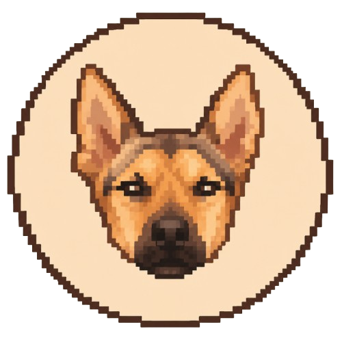

<p align="center"></p>

# HomeTasks Dashboard

## Overview
HomeTasks Dashboard is a web application designed to help users manage their daily hometasks effectively. It provides features such as task tracking, lifespan management, and dynamic updates.

## Features
- Add new tasks with a specified lifespan.
- Refresh tasks to reset their lifespan.
- Visual indicators (color-coded) for task status based on time elapsed.
- Dynamic display of today's date.

## Development Setup Instructions
1. Clone the repository:
   ```bash
   git clone <repository-url>
   ```
2. Navigate to the project directory:
   ```bash
   cd hometasks-dashboard
   ```
3. Create and activate a virtual environment:
   ```bash
   # Create virtual environment
   python3 -m venv venv
   
   # Activate virtual environment
   # On macOS/Linux:
   source venv/bin/activate
   
   # On Windows:
   # venv\Scripts\activate
   ```
4. Install dependencies:
   ```bash
   pip install -r requirements.txt
   ```
5. Run the application:
   ```bash
   python app.py
   ```
6. Open the application in your browser at `http://localhost:5555`.

**Note:** Always activate the virtual environment before running the application or installing dependencies.

## Running with Docker Compose (dashboard + Telegram bot)

`docker-compose.yml` starts three containers:

| Service | Purpose |
|---|---|
| `hometasks-dashboard` | The web app on port 5555 |
| `hometasks-bot` | The Telegram bot (optional, see below) |

### What you need on the host

Only `docker-compose.yml` and a `.env` file are required (images are pulled from Docker Hub). Put them in one folder and create the two data folders **manually before the first start**:

```
my-folder/
├── docker-compose.yml
├── .env              # you create this (see "Telegram bot" below)
├── data/             # you create this: dashboard tasks and history
└── bot_data/         # you create this: bot state (authorised chats)
```

```bash
mkdir -p data bot_data
```

> If `bot_data/` (or `data/`) is missing, the container fails to start with a mount/permission error. Create both folders first.

### Start

```bash
docker compose up -d
# or rebuild from local sources: docker compose up -d --build
docker compose logs -f hometasks-bot   # check the bot is running
```

Open the dashboard at `http://localhost:5555`.

If you do not want the bot, delete the `hometasks-bot` service from `docker-compose.yml` (and `bot_data/`, `.env` are then not needed).

## Telegram bot

The bot is password-protected and lets you manage tasks from Telegram:

- Notifies you when a task turns yellow or red.
- Saturday reminder (default 10:00) listing tasks to bring back to green; optional daily digest.
- Commands: `/todo` (tasks needing attention), `/list` (all tasks), `/done` (mark any task as done), `/report` (statistics for 30 days, 90 days or all time), `/help` (list of commands).

### Configure it

1. **Create the bot**: in Telegram open [@BotFather](https://t.me/BotFather), send `/newbot`, pick a name and username, and copy the **token** it gives you.
2. **Create the `.env` file** next to `docker-compose.yml`:
   ```env
   BOT_TOKEN=123456789:your-token-from-botfather
   BOT_PASSWORD=choose-a-long-password
   TZ=Europe/Paris
   DASHBOARD_URL=http://<dashboard-host>:5555
   ```
   - `BOT_TOKEN`: from BotFather (required).
   - `BOT_PASSWORD`: anyone who sends this to the bot gets access, so make it long and private (required).
   - `DASHBOARD_URL`: address the bot uses to reach the dashboard (required), e.g. your self-hosted DNS name or the compose service name with port 5555.
   - `TZ`: your timezone, used for the Saturday/daily messages.
   
   `.env` is git-ignored and must never be committed.
3. **Create the folders** and start: `mkdir -p data bot_data && docker compose up -d`.
4. **Connect**: open your bot in Telegram, send `/start`, then send the password. The bot deletes your password message and remembers your chat (stored in `bot_data/`). Repeated wrong passwords are temporarily locked out.

### Optional settings

Set in the `environment:` section of `hometasks-bot` in `docker-compose.yml`:

| Variable | Default | Meaning |
|---|---|---|
| `SATURDAY_TIME` | `10:00` | Time of the Saturday reminder |
| `DAILY_DIGEST_TIME` | disabled | e.g. `09:00` for a daily priorities message |
| `CHECK_INTERVAL` | `60` | Seconds between dashboard checks for status changes |

## Usage
- Add tasks using the input fields and "Add" button.
- Refresh tasks by clicking the refresh icon next to each task.
- View task status with color-coded indicators:
  - **Green**: Task is fresh.
  - **Yellow**: Task is halfway through its lifespan.
  - **Red**: Task has expired.

## File Structure
- `static/`: Contains JavaScript and CSS files.
- `templates/`: Contains HTML templates.
- `app.py`: Main application file.
- `data/`: Stores task data in JSON format (git-ignored).
- `bot/`: Telegram bot source and Dockerfile.
- `bot_data/`: Bot state (git-ignored, create manually for Docker).

## License
This project is licensed under the MIT License.